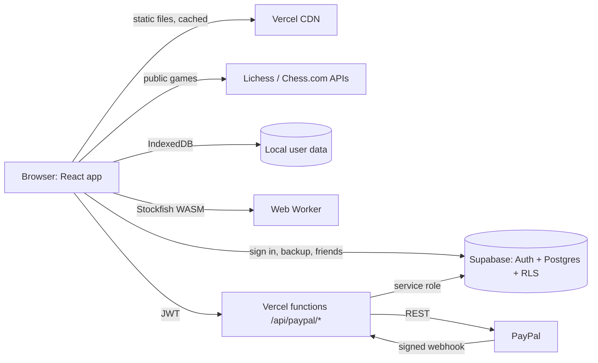

# Architecture (modular monolith: one React app + a few serverless functions)

## Layers
| Layer | Where | Rule |
|---|---|---|
| UI | `src/*.jsx`, `src/features/*/*.jsx` | no business rules, always handle loading / empty / error |
| Business rules | `*Core.js`, `backupCore.js`, `api/_lib/subscriptionLogic.js` | pure, unit tested |
| Storage | `src/storage.js`, `src/features/cloud/cloud.js` | the only code that touches IndexedDB / `user_backups` |
| Server | `api/` | validates input, checks auth, rate limits, uses service role |
| Database | `sql/*.sql` | RLS on, one file per change |

## Background work
No queue is needed at this scale. PayPal webhooks are processed inside the request but are idempotent (event id table), and
PayPal retries failures. Analysis runs in a Web Worker on the user's device.

## Third-party services (and cost at launch)
Vercel (free hobby; commercial use needs Pro), Supabase (free tier: 500 MB database), PayPal (fee per payment), Google Forms (free).

## Three riskiest decisions
1. Data lives on the device: a cleared browser loses it unless a backup exists -> export + optional cloud backup + persistent storage request
2. Gating Pro features on the client cannot be tamper-proof -> only gate things where that is acceptable; money flows are server-verified
3. One shared Supabase project for dev and prod -> create a second project for staging before real money flows
